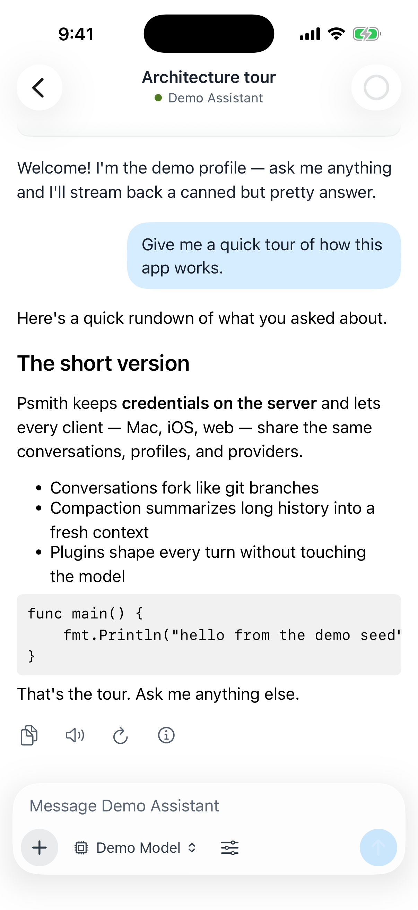
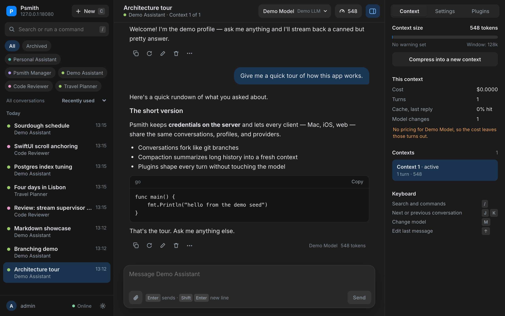
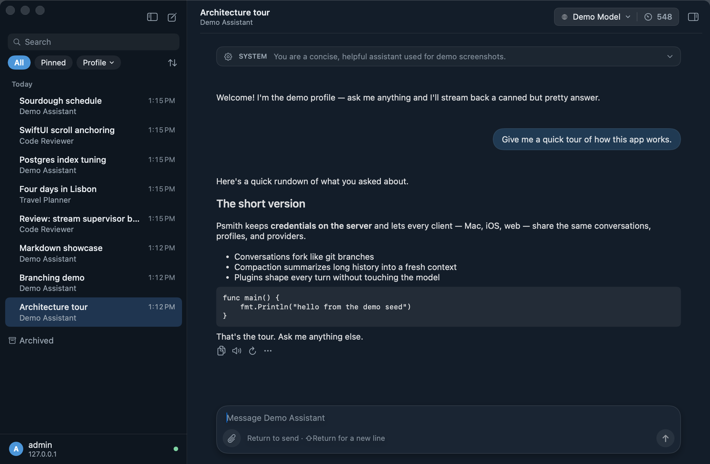
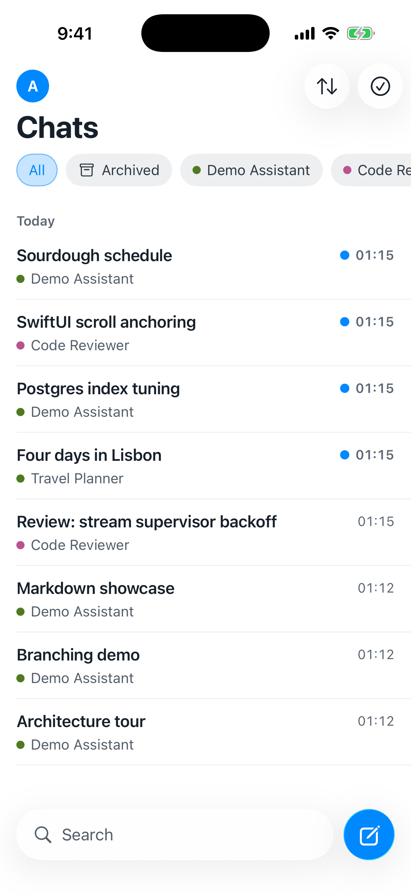
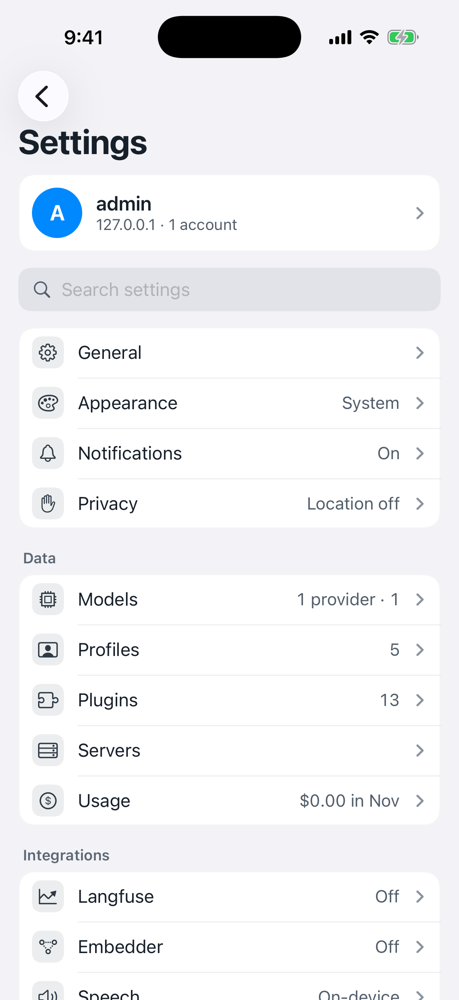
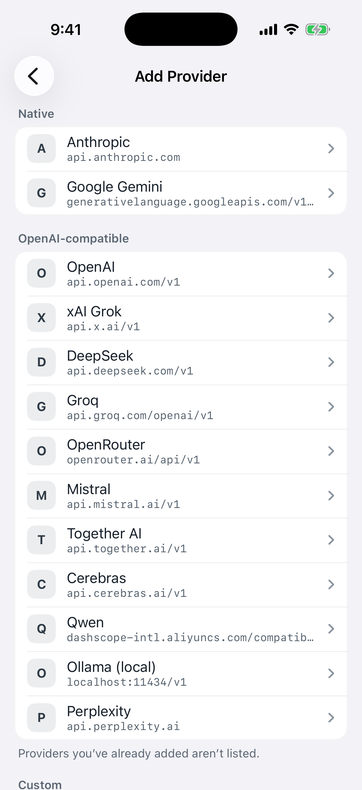
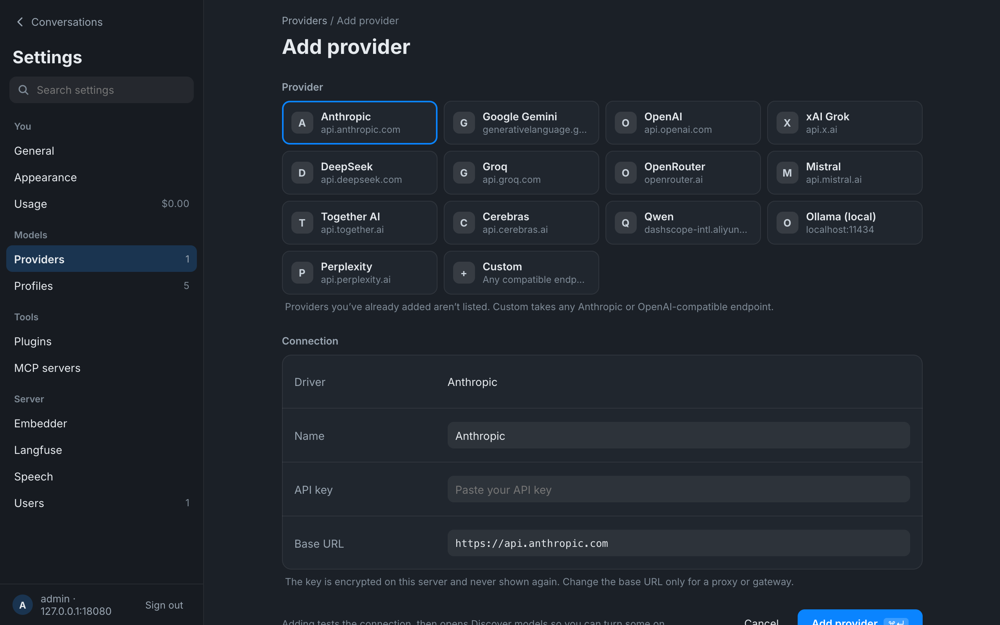
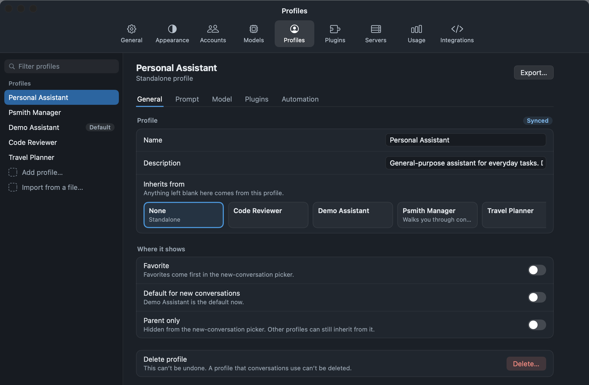

# Psmith

*Pronounced "Smith". The P is silent, as in pshrimp.*

Psmith is a self-hosted AI chat orchestrator. It puts cloud APIs (Anthropic, OpenAI, Google, OpenRouter, anything OpenAI-compatible) and local agentic CLIs (Claude Code, Codex) behind one chat UI. The server owns history and consumes every stream to completion, so clients can disconnect and reconnect without losing a token.

It's a personal project. The roadmap, scope, and tradeoffs are biased toward "one developer using this every day," not "platform for many tenants."

> **Human Note:**
>
> Psmith was built to scratch an itch. It's entirely vibe-coded, but I use it frequently and it works well. It's "ChatGPT with any model and provider and a lot of configuration". I make no claims as to the code quality, because I didn't write it, but I did do my best to constrain the architectural path to something which seemed sane to me.

<p align="center">
  
</p>

## Why this exists

Off-the-shelf chat UIs make easy things easy and hard things impossible. Psmith trades polish for knobs.

- Mix providers in one conversation. Pick the model per turn: ask Claude for code, hand the result to Gemini for review, settle the dispute with GPT-5.
- The server owns the stream. It reads every upstream provider stream to the end whatever the client does. Background the app, come back five minutes later, and the reply is finished and waiting.
- Conversations are trees, not lists. Fork from any message; every client shows sibling counts and lets you switch branches.
- Compression is manual. Compress on demand into a new context, with a summary you review and edit before it takes over.
- Profiles bundle configuration: system message, default model, compression behavior and plugins. They attach to a conversation and inherit from parent profiles.
- Plugins are compile-time Go code. One interface set covers system-prompt contributions, outgoing rewrites, history transforms, inbound chunk processing, display rewrites and tools.

## Status

A personal project, used daily. Working today:

- Anthropic, OpenAI (Chat Completions and Responses), Google Gemini, and any OpenAI-compatible endpoint. Thirteen built-in presets (OpenAI, Anthropic, Google, xAI, DeepSeek, Groq, OpenRouter, Mistral, Together, Cerebras, Qwen, Ollama, Perplexity) each carry their provider's quirks.
- Claude Code and Codex as stateful providers. The server holds their session handles per branch, so forking a harness conversation works.
- Streaming, branching, editing, deleting, and two-stage manual compression.
- Cost and token tracking per message and per context, a cache-efficiency dot, prompt caching across Anthropic, OpenAI and Google, and auto-titling through a cheap model (or Apple Foundation Models on macOS).
- Per-conversation overrides (`temperature`, `max_output_tokens`, thinking effort and more), resolved through four layers: conversation, profile, model, provider.
- Three clients. The macOS and iOS apps (SwiftUI) share repositories, view models and most views through the `PsmithSwift` package. The iOS app reattaches to in-flight server streams on resume and stays readable offline through a SwiftData cache. The web client is server-rendered and built into psmithd; replies stream into the page live, and every tab shares one account event stream.
- Tool use end to end: server-side tools (web search, memory, image generation) and on-device tools (Calendar, Reminders, Health, Obsidian on iOS), with an audit log, per-call permissions and mid-call elicitation.
- Opt-in embeddings power a `search_history` tool. A `/mcp` endpoint exposes a curated subset of the API. Per-user Langfuse config emits traces.

Deferred: APNs push on iOS, multi-user sharing, and encryption at rest beyond host disk encryption. See [`docs/`](docs/README.md) for the full picture.

## What it looks like

The same server behind every client. These are a demo account seeded by [`cmd/demo-seed`](cmd/demo-seed/main.go) against its fake model.

The web client, with the conversation inspector open:

<p align="center">
  
</p>

The macOS app:

<p align="center">
  
</p>

The iOS chats list, settings, and the provider presets:

<p align="center">
  
  
  
</p>

Settings on the web and the Mac:

<p align="center">
  
  
</p>

## Architecture

```
┌──────────────┐    ┌────────────────────────┐    ┌──────────────┐
│  Provider    │───▶│  Stream supervisor     │───▶│  Postgres    │
│  (Anthropic, │    │  (goroutine per run)   │    │  stream_runs │
│   OpenAI,    │    │                        │    │  + chunks    │
│   harness…)  │    │  + in-process pub/sub  │    └──────┬───────┘
└──────────────┘    └─────────┬──────────────┘           │
                              │                          │
                              ▼                          │
                       ┌──────────────┐                  │
                       │  Subscribers │◀─────────────────┘
                       │  (clients)   │   (replay from
                       └──────────────┘    sequence N)
```

The server is Go: a single binary (`psmithd`), Postgres for storage, ConnectRPC for transport. Model metadata comes from an in-process [models.dev](https://models.dev) catalog, snapshotted onto each model row when the provider is added.

The clients are SwiftUI on macOS 26 and iOS 26, sharing the `PsmithSwift` package (`PsmithKit` and `PsmithUI`), plus the server-rendered web client (templ, htmx and server-sent events).

There's no multi-provider framework. Drivers use each vendor's official SDK directly, so provider-specific features survive intact. The OpenAI-compatible driver carries a small per-preset `Quirks` overlay.

The full design lives under [`docs/`](docs/README.md), one document per subsystem. Start at [`docs/README.md`](docs/README.md) or [`docs/design/overview.md`](docs/design/overview.md), and read it before working in the repo.

## Repo layout

```
cmd/psmithd/     # server entrypoint
cmd/psmith/      # operator CLI (install, useradd, genkey)
cmd/demo-seed/   # demo account and fake model, for screenshots and e2e tests
proto/           # ConnectRPC service definitions
gen/             # generated Go bindings (buf)
db/migrations/   # goose-format SQL migrations
server/          # server packages (auth, conversations, providers, stream, web, …)
claudesdk/       # Claude Code harness SDK
codexsdk/        # Codex harness SDK
pluginapi/       # the plugin contract, importable out-of-tree
plugins/         # the built-in plugins, one package per folder
clients/         # PsmithSwift package + macOS and iOS apps
docs/            # authoritative documentation
```

## Running it

The fastest path is Docker Compose:

```bash
cp .env.example .env        # set POSTGRES_PASSWORD and PSMITH_MASTER_KEY
docker compose -p psmith up -d
docker compose -p psmith exec psmithd psmith useradd -u alice
# open http://localhost:8080
```

That's one of three supported ways to run it. The full walkthrough covers Docker Compose, a single Docker container against your own Postgres, and building from source with `go build`, plus configuration and the clients: [`docs/operations/installation.md`](docs/operations/installation.md).

The web client is served by psmithd at its root. The native clients build with `make mac-app-run` and `make ios-app-run`.

## Development

```bash
make test         # Go suite (unit, pgtestdb integration, headless-Chrome web tests)
make swift-test   # Swift L1 integration + L2 snapshot
make mac-e2e      # Mac end-to-end against a real psmithd, offscreen
make ios-e2e      # iOS end-to-end in the simulator
make proto sqlc   # regenerate ConnectRPC and query bindings
```

Build and codegen details are in [`docs/operations/building-and-codegen.md`](docs/operations/building-and-codegen.md), and the testing posture in [`docs/testing-plan.md`](docs/testing-plan.md). Adding a provider driver and adding a chat plugin are covered in [`docs/design/providers.md`](docs/design/providers.md) and [`docs/design/plugins.md`](docs/design/plugins.md). `CLAUDE.md` makes test coverage a hard rule: don't merge a vertical slice without tests.

## License

MIT. See [`LICENSE`](LICENSE).
